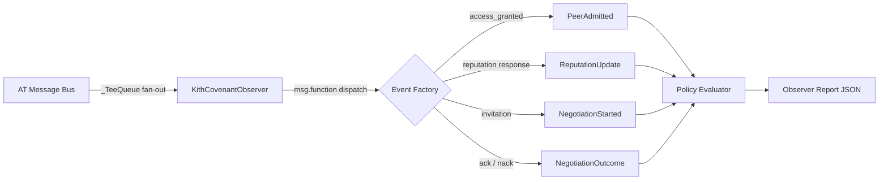

# Policy Evaluation Architecture

The Kith-Covenant evaluation framework connects the AutonomousTrust (AT) simulator to Kith-Covenant group protocol policies. It observes live AT message traffic, translates it into typed events, scores policy compliance, and produces a single fitness value suitable for automated comparison or future ML-driven optimization.

## Split-Package Design

Ownership is divided across two packages with a one-way dependency:

| Package | Location | Owns |
|---------|----------|------|
| **Kith-Covenant library** | `lib/kith-covenant/src/python/kith_covenant/` | Event types, policy schema, evaluator protocol |
| **AT simulator** | `evaluation/kith_covenant/` | Observer process, evaluation harness, Docker integration |

The simulator imports from the Kith-Covenant library. The Kith-Covenant library has no dependency on AT internals. This boundary keeps the policy schema stable and reusable. Hand-crafted policies and future ML-generated policies target the same types.

## Event Model

The `KithCovenantObserver` process receives raw AT `Message` objects from the simulator's message bus and translates them into frozen dataclasses defined in `kith_covenant.interface`. Policies reason exclusively about these typed events, never about raw messages.

### Event Type Mappings

| Event Class | Source `msg.function` | Fields |
|-------------|----------------------|--------|
| `PeerAdmitted` | `access_granted` | `peer_id`, `timestamp` |
| `ReputationUpdate` | `reputation response` | `peer_id`, `score`, `timestamp` |
| `NegotiationStarted` | `invitation` | `task_id`, `initiator_id`, `timestamp` |
| `NegotiationOutcome` | `ack` / `nack` | `task_id`, `success`, `timestamp` |

Messages with functions not in this table (e.g. `request_access`, `peer_accepted`, `haggle`) are silently ignored. They represent intermediate protocol steps whose outcomes are captured by the mapped events.

Field extraction follows the `MetricsCollector` pattern: `peer_id` comes from `msg.from_whom` (inbound) or `msg.to_whom[0]` (outbound); `task_id` comes from `msg.obj.uuid` when the object is a `TaskInfo`.

## KithCovenantPolicy

A frozen dataclass in `kith_covenant.policy` holding numeric thresholds that govern group behavior. Immutability ensures a policy cannot be modified during evaluation.

### Fields

| Field | Type | Description |
|-------|------|-------------|
| `min_reputation_to_negotiate` | `float | None` | Peers below this score are ineligible for negotiation. `None` disables the check. |
| `defection_cooldown_s` | `float | None` | Seconds a peer must wait after dropping below threshold before re-eligibility. |
| `max_group_size` | `int | None` | Cap on peers for consensus operations. `None` means unlimited. |
| `bandwidth_priority_by_rank` | `bool` | Whether higher-reputation peers get bandwidth allocation priority. |

### Shipped Policies

| Name | `min_reputation` | `cooldown_s` | `max_group` | `priority` | Purpose |
|------|----------------:|-------------:|------------:|:----------:|---------|
| **NullPolicy** | `None` | `None` | `None` | off | Baseline: no rules applied |
| **PermissivePolicy** | 0.2 | 30 | 50 | off | Light guardrails for large groups |
| **StrictPolicy** | 0.5 | 120 | 10 | on | Tight control for high-trust clusters |

### Serialization and ML Integration

`to_dict()` and `from_dict()` support JSON round-tripping. `from_dict()` ignores unknown keys, so a future Transformer model can emit a superset dict and `KithCovenantPolicy.from_dict(model_output)` will extract exactly the recognized fields. No adapter layer is needed.

## _TeeQueue Fan-Out

The AT simulator's `_TeeQueue` wraps the real message queue and copies every `put()` call to a list of observer queues. Observer processes declare themselves with a class attribute `is_tee_observer = True`. During startup, `InstrumentedAT.run_forever()` discovers all observer processes, collects their queue references, and passes them to `_TeeQueue`.

This generalizes the original single-observer design (MetricsCollector only) to N observers. The constructor accepts either a single queue or a list for backward compatibility. If an observer's queue is full, the copy is silently dropped: observers must not block the main message path.

## Fitness Function

The evaluator computes a weighted sum of normalized metrics. Each metric is scaled to [0, 1] before weighting.

| Metric | Weight | Normalization | Source |
|--------|-------:|---------------|--------|
| Cooperation rate | 0.30 | Raw ratio (successful / total negotiations) | Observer |
| Policy compliance rate | 0.25 | Raw ratio (compliant / total evaluated) | Observer |
| Identity convergence | 0.15 | `1 - min(convergence_s / 120, 1.0)` | Metrics collector |
| Reputation stability | 0.15 | `1 - min(stddev / 0.5, 1.0)` | Metrics collector |
| Task throughput | 0.10 | `min(throughput / 1.0, 1.0)` (negotiations/sec) | Observer |
| Bandwidth overhead | 0.05 | `1 - min(fraction / 1.0, 1.0)` | Metrics collector |

Weights and normalization bounds are constructor parameters so they can be tuned per experiment. A `None` metric value scores 0.

## Evaluator Backends

Both backends implement `KithCovenantEvaluatorProtocol` and return an `EvaluatorResult` containing the policy, observer report, metrics report, and fitness score.

**InProcessEvaluator** instantiates `KithCovenantInstrumentedAT` directly with mock peers. Runs in seconds. Suitable for rapid iteration and unit-level validation.

**DockerEvaluator** extends the existing `test-simulation-scenarios.sh` script with a `--kith-covenant-policy <path>` flag. Launches a full multi-node Docker simulation with one instrumented node running `KithCovenantObserver`. Reads output JSON from a bind-mounted directory. Runs in minutes but tests real multi-node dynamics.

Because both backends return the same `EvaluatorResult`, scores are directly comparable across backends.

## KithCovenantInstrumentedAT

`KithCovenantInstrumentedAT` subclasses `InstrumentedAT` and registers `KithCovenantObserver` as an additional worker alongside `MetricsCollector`. No override of `run_forever()` is needed. The generalized `_TeeQueue` in the parent class handles fan-out to all observers discovered via `is_tee_observer`.

## Automated Evaluation Loop

The intended end-to-end flow:

1. Define a `KithCovenantPolicy` (hand-crafted now, ML-generated later).
2. Run an AT simulation with the policy active via `KithCovenantObserver`.
3. Collect observer and metrics reports.
4. Score the policy through the fitness function.
5. *(Future)* Feed scores to an ML model that generates the next policy candidate.

Steps 1 through 4 are implemented. Step 5 is the integration point: `KithCovenantPolicy.from_dict()` accepts model output directly.
